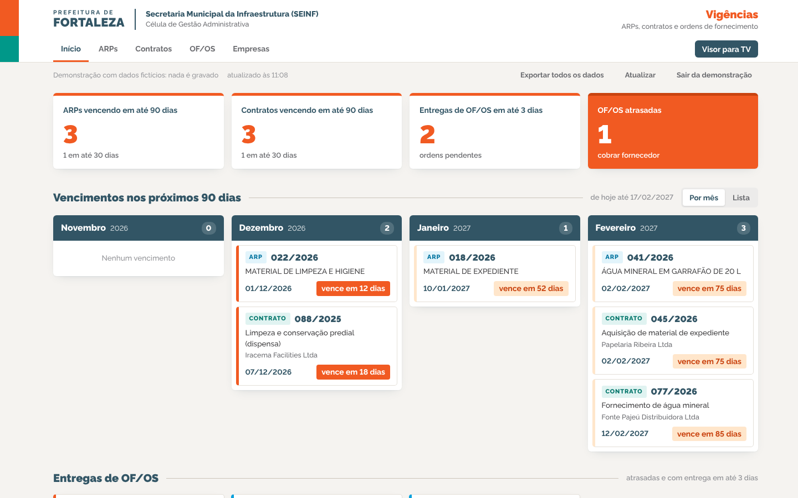
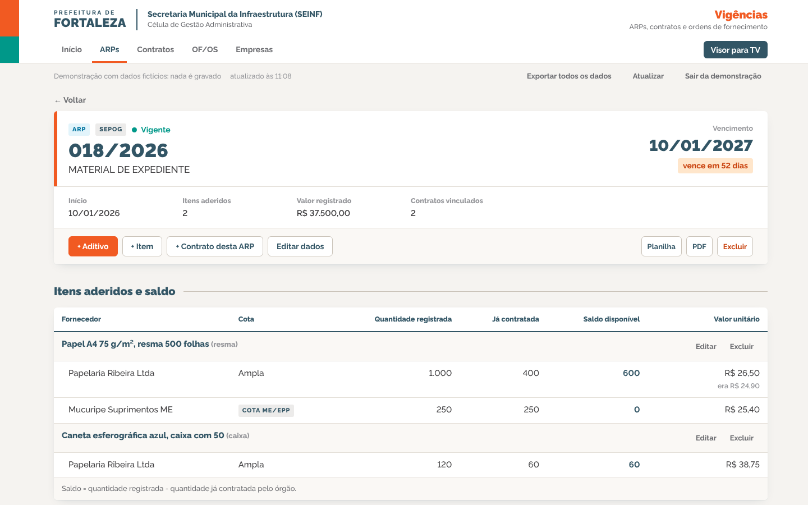
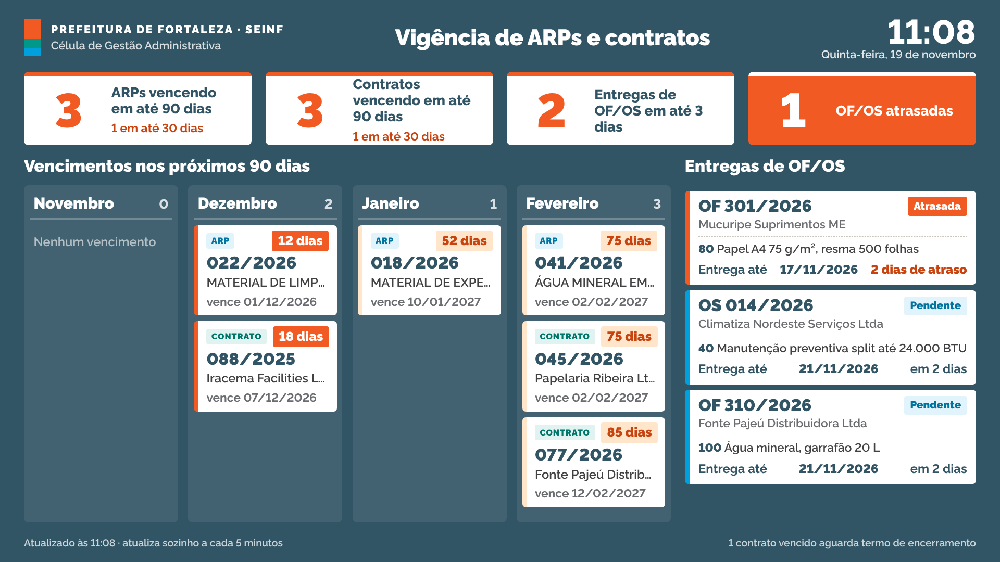

# Vigências

[](https://github.com/codeNilson/CEGEA-vigencias/actions/workflows/ci.yml)

Acompanhamento de vigência de ARPs (Atas de Registro de Preços) e contratos da Célula de Gestão Administrativa da Secretaria Municipal da Infraestrutura (SEINF), Prefeitura de Fortaleza. Controla saldos, aditivos e ordens de fornecimento e de serviço, e destaca o que está perto de vencer para que nenhum prazo de renovação seja perdido.

O sistema é **um único arquivo HTML**, aberto no Google Chrome a partir de uma pasta de rede. Não tem servidor, login nem dependência de internet. Os dados ficam em arquivos JSON na própria pasta de rede, e várias pessoas podem editar ao mesmo tempo sem perder alterações.



## Funcionalidades

- **ARPs**: itens aderidos, um ou mais fornecedores por item (ampla e cota ME/EPP), saldo por fornecedor, aditivos de prazo, quantidade e reequilíbrio econômico-financeiro.
- **Contratos**: vinculados ou não a uma ARP, com saldo por período de vigência, aditivos de prazo, valor e reequilíbrio, histórico de valores e encerramento.
- **OF/OS**: prazo de entrega em dias úteis (com feriados de Fortaleza) ou corridos, alerta de entregas próximas e atrasadas.
- **Início**: contadores, vencimentos dos próximos 90 dias por mês ou em lista, entregas a cobrar.
- **Visor para TV**: tela própria para deixar ligada, com letras grandes, atualização automática e paginação.
- **Empresas**: busca, paginação, contato e aviso de cadastro repetido.
- **Edição concorrente segura**: versão por arquivo, mesclagem em três vias e tela para resolver conflitos.
- **Exportação**: planilha .xlsx por tela, PDF pela impressão e exportação completa dos dados em uma planilha independente.
- **Atualização pelo próprio sistema**: avisa quando há versão nova, mostra as novidades e instala com um clique para todos.

| Ficha da ARP | Visor para TV |
|---|---|
|  |  |

## Instalação na pasta de rede

1. Baixe `Vigencias.html` da [última versão publicada](https://github.com/codeNilson/CEGEA-vigencias/releases/latest).
2. Copie para a pasta de rede do setor e crie, ao lado dele, uma pasta vazia chamada `dados`.
3. Abra `Vigencias.html` no **Google Chrome**, clique em "Escolher pasta de dados" e escolha a pasta `dados`. Na primeira vez o sistema cria `_vigencias.json` e as subpastas.
4. Cada colega faz o passo 3 uma vez no próprio computador. Depois, o Chrome pede só um clique de confirmação.

```
\\servidor\setor\Vigencias\
  Vigencias.html
  dados\
    _vigencias.json
    empresas\<id>.json
    atas\<id>.json
    contratos\<id>.json
```

Os dados não são tocados por atualizações, e arquivos gravados por versões anteriores continuam válidos.

Para conhecer sem gravar nada, use "Conhecer com dados fictícios" na tela inicial ou abra `Vigencias.html?demo`.

### Atualizações

A partir da versão 1.5.0, o sistema consulta o GitHub ao abrir e a cada 6 horas. Quando há versão nova, aparece a faixa **Nova versão disponível**:

1. Clique em **Ver novidades e atualizar**, leia as notas e clique em **Atualizar agora**.
2. Na primeira vez, em cada computador, escolha a pasta onde fica o `Vigencias.html` (a pasta acima de `dados`).
3. O sistema baixa, confere o arquivo, guarda uma cópia da versão atual em `versoes-anteriores` e recarrega.

Basta uma pessoa atualizar: o arquivo é o mesmo para todos. Quem estiver com o sistema aberto recebe o aviso para recarregar e não consegue salvar até recarregar; a TV recarrega sozinha. Sem internet, nada muda, e a consulta é repetida depois. A versão em uso aparece na faixa de status.

Da 1.4.0 (ou anterior) para a 1.5.0, a troca é manual uma única vez: copie o `Vigencias.html` da versão 1.5.0 por cima do atual.

### Visor para TV

1. No computador ligado à TV, abra `Vigencias.html`, conecte a pasta `dados` e clique em **Visor para TV**.
2. Mova o mouse e clique em **Tela cheia** (ou F11). No mesmo menu, **Ver em lista** e **Ver por mês** trocam o modo.
3. Deixe o Chrome aberto e o computador sem suspensão. O visor relê a pasta a cada 5 minutos e vira o dia sozinho.

### Exportar todos os dados

O botão **Exportar todos os dados** gera uma planilha com as abas ARPs, Itens das ARPs, Contratos, Itens dos contratos e Empresas. Só valores, sem fórmulas nem vínculos entre abas. Serve como cópia de segurança legível e como saída caso o sistema deixe de ser usado.

## Desenvolvimento

Requer Node.js 20 ou superior (versão de referência em `.nvmrc`).

```
npm install
npm run dev        # servidor de desenvolvimento, abre a demonstração
npm test           # testes (Vitest): domínio, seletores, gravação concorrente, exportação
npm run typecheck  # verificação de tipos
npm run build      # gera dist/Vigencias.html, arquivo único sem dependências externas
npm run preview    # serve o build para conferência
```

### Fluxo de trabalho

As alterações são feitas com o Claude Code, seguindo o [`CLAUDE.md`](CLAUDE.md). Alterar e publicar são etapas separadas:

```
pedido de alteração ─▶ branch claude/<assunto> ─▶ PR (CI) ─▶ aprovação ─▶ main
                                                                         │
                       CHANGELOG: item em [Não publicado]  ◀─────────────┘
                                                                         │
"publica" ─▶ versão X.Y.Z no CHANGELOG e package.json ─▶ tag vX.Y.Z ─▶ setor atualiza
```

- **`main`**: sempre funcionando, acumula mudanças ainda não publicadas. Juntar na `main` não muda nada para o setor.
- **`claude/<assunto>`**: uma branch e um PR por pedido. O CI roda no PR; a mudança só entra na `main` com aprovação.
- **`CHANGELOG.md`**: a cada mudança visível, o Claude escreve o item na seção `[Não publicado]`, em linguagem para quem usa o sistema.
- **Publicar**: quando quiser lançar o que acumulou, peça "publica". O Claude escolhe o número (correção 1.5.**1**, novidade 1.**6**.0), fecha a seção do CHANGELOG, atualiza o `package.json` e cria a tag `vX.Y.Z`. O workflow **Publicar versão** roda testes e build, confere a tag, atualiza a branch `publicacao` (de onde o sistema lê) e cria a Release. Os computadores do setor veem a versão nova ao abrir ou em até 6 horas.
- **Voltar atrás**: publique uma versão nova com o código anterior.

Os builds da `main` (artefato do CI) servem para conferência; para a pasta de rede, use só versões publicadas.

O `index.html` da raiz é só o modelo de desenvolvimento e não funciona aberto direto.

### Tecnologias

React 18, TypeScript, Vite com `vite-plugin-singlefile`, Zustand, Zod, SheetJS e File System Access API. Os motivos de cada escolha estão em [`docs/design.md`](docs/design.md), seção 5.

### Estrutura

```
src/dominio/        regras puras: schemas (zod), datas, feriados, prazos, situação, saldos,
                    valores, validações, dependências, mesclagem, texto e busca
src/armazenamento/  PastaRede (File System Access API) e Memoria (testes e demonstração);
                    IndexedDB para a referência da pasta e cache de leitura
src/estado/         loja (Zustand): carga, gravação com versão e mesclagem, seletores, demo
src/exportacao/     planilhas .xlsx; PDF via impressão do Chrome
src/ui/             telas React, componentes, estilos e preferências por computador
docs/               requisitos, design e capturas de tela
```

### Onde ajustar regras

| O quê | Arquivo |
|---|---|
| Lista de feriados | `src/dominio/feriados.ts`, constante `FIXOS` |
| Antecedência de 90 dias | `src/dominio/calculos.ts`, `ALERTA_VIGENCIA_DIAS` |
| Destaque forte a partir de 30 dias | `src/dominio/calculos.ts`, `ALERTA_CRITICO_DIAS` |
| Antecedência de 3 dias da OF/OS | `src/dominio/prazos.ts`, `ALERTA_ORDEM_DIAS` |
| Nome do órgão e do setor | `src/ui/orgao.ts` |
| Visor: recarga, troca de página, cartões por coluna | `src/ui/telas/Visor.tsx`, constantes no topo |
| Intervalo de verificação de alterações (2 min) | `src/ui/App.tsx`, `INTERVALO_VERIFICACAO` |

## Documentação

- [`docs/requisitos.md`](docs/requisitos.md): requisitos funcionais, critérios de aceite e fora do escopo.
- [`docs/design.md`](docs/design.md): arquitetura, modelo de dados, edição concorrente e tecnologias.
- [`CHANGELOG.md`](CHANGELOG.md): mudanças por versão.
- [`CLAUDE.md`](CLAUDE.md): orientações para agentes de código.

## Identidade visual

Paleta e tipografia do Manual de Identidade Visual da Prefeitura de Fortaleza 2025-2028. A fonte é a Raleway com algarismos alinhados, equivalente gratuita da Rawline. Fox Grotesque e Aribau Grotesk são pagas e não foram embutidas. O brasão não é reproduzido; a assinatura institucional é em texto.
